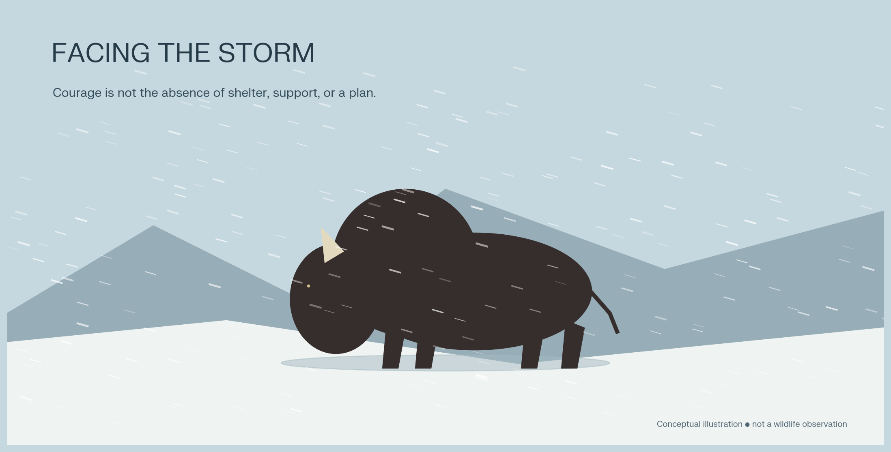
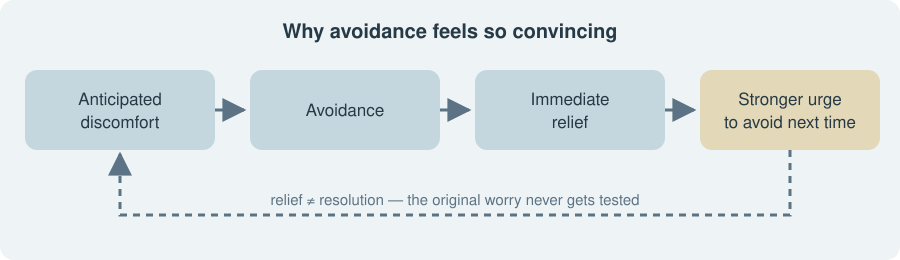
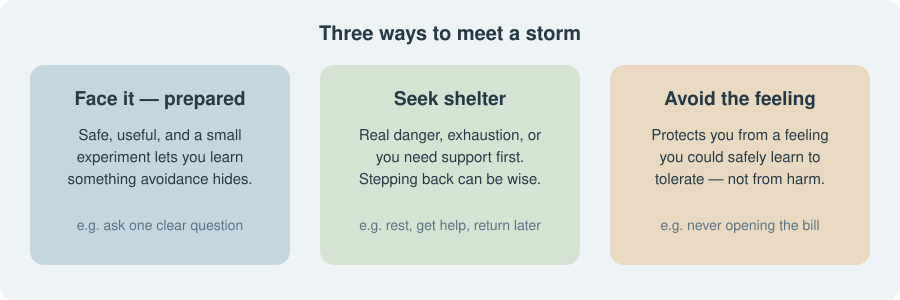

*Original conceptual illustration — not a wildlife observation.*

*The animal story is more complicated than the viral post suggests. The human lesson is still worth keeping.*

Imagine an uncomfortable conversation waiting for you on Monday morning. You could start it now, but instead you make another coffee, clear a few emails, and decide tomorrow would be better.

For a moment, you feel lighter. Nothing has changed — except that you no longer have to think about it.

That small moment of relief is the heart of a post that has been doing the rounds: turning away from discomfort can feel helpful while leaving the underlying problem untouched. Psychology supports this concern about avoidance, although the bison story used to explain it needs a little untangling.[^1]

---

## First, do bison really walk into storms?

There is truth in the story — but not enough to support every motivational caption built around it.

Bison have been observed facing into winter storms. Their heavily protected heads and shoulders help explain why: facing the wind presents a well-insulated part of the body to the weather and helps keep cold air and moisture from blowing beneath their coats. Bison specialist Jeff Martin told Snopes that the behaviour is more accurately described as *facing* the storm than necessarily *walking through* it.[^2]

What has not been established is that bison deliberately move into storms because they "know" this will shorten their exposure. Snopes' fact-check rates that part as false: there is no evidence they know facing a storm will get them through it quicker; rather, their fur and metabolism let them withstand the conditions. Walking upwind through deep snow also costs energy, so moving forward is not automatically the best survival strategy.[^2]

Nor do all bison respond the same way. A National Park Service scientific monograph on Yellowstone's bison reported that, during severe snowstorms, the animals were not seen standing head-on into the wind. They were bedded in the snow, usually in whatever protection small variations in terrain offered, and at times moved with the wind, sometimes into the trees at the edge of the wintering valleys. The same monograph also records an account of bison facing into the most severe storms on open feedgrounds. The setting matters.[^3]

So the careful conclusion is:

> Bison sometimes face storms. That does not prove they follow a universal rule of charging through hardship to finish it faster.

This correction does not ruin the metaphor. It makes it more useful: resilience may involve facing a challenge, finding shelter, or conserving energy — not simply pushing harder.

---

## Why avoidance feels so convincing

Imagine that you are worried about checking your bank balance.

You postpone opening the app. Your anxiety drops. Tomorrow, when the same worry returns, postponing it feels tempting again.

Psychologists call this **negative reinforcement**: removing an unpleasant feeling can strengthen the behaviour that removed it. "Negative" here means taking something away, not passing a moral judgement. Avoidance can therefore become rewarding even when it leaves the original concern unresolved.[^1]

The problem is not that relief is bad. It is that relief and resolution are different things.

Repeated avoidance can also block new learning. If you never ask a question in a meeting, you never discover whether people would actually dismiss you — or whether you could cope even if your wording were imperfect. Research on anxiety describes how avoidance can preserve expectations of threat by preventing experiences that might challenge them.[^1]

In everyday terms, we sometimes mistake "I escaped feeling nervous" for "I escaped something dangerous."

---

## What facing discomfort actually teaches us

The strongest psychological version of the bison lesson is not "suffer more now so you can suffer less later."

It is: *give yourself a chance to learn something that avoidance prevents you from learning.*

**Exposure therapy**, a core component of cognitive behavioural therapy for anxiety disorders, uses encounters with feared situations to support new learning. Research increasingly emphasises changing expectations about harm, rather than treating a drop in fear during every encounter as the only measure of success.[^1]

Consider a hypothetical person who fears speaking in meetings.

Their prediction might be: "If I hesitate, everyone will think I am incompetent."

A small experiment could be to ask one relevant question. They may still feel nervous. They may even stumble. But the experience could offer a different conclusion: "I hesitated, and the conversation continued."

That is a more durable kind of confidence than waiting to feel perfectly ready. It is not a promise that nothing awkward will happen. It is evidence that awkwardness may be manageable.

This is a reasonable everyday application of exposure principles — not a substitute for personalised treatment when anxiety is severe.[^1]

---

## The important exception: not every storm deserves your presence

"Face your fears" becomes poor advice when it treats all fear as mistaken.

Leaving a genuinely unsafe situation is not a failure of courage. Neither is stepping back temporarily when doing so helps you regain control and return with better support.

In their review, psychologists Stefan Hofmann and Aleena Hay argue that avoidance should be judged by its function. Some avoidance maintains anxiety; other forms prevent real harm, make a situation manageable, or help a person approach a challenge later.[^1]

That gives us a better question than "Am I being brave?"

> Is this choice protecting me from real harm — or mainly protecting me from a feeling I could safely learn to tolerate?

Even that question needs context. A difficult conversation with a reasonable colleague is different from confronting someone who has threatened you. Preparing for a presentation is different from ignoring exhaustion.

The goal is flexibility, not a permanent setting of "push through."

---

## A gentler way to face your next storm

The following is a practical reflection exercise inspired by research on avoidance and learning — not a clinical treatment protocol. Its purpose is to turn a vague fear into a small, informative action.[^1]

### 1. Name the specific thing you are avoiding

Replace "I need to sort my life out" with something observable:

- Open the overdue bill.
- Ask for clarification about the project.
- Book the appointment.
- Tell a friend that a comment hurt.

A named task gives you something concrete to work with.

### 2. Separate the task from the prediction

Write two short sentences:

- "The task is to ask my manager which deadline takes priority."
- "My prediction is that asking will make me look incapable."

They are not the same statement. One describes an action; the other describes an anticipated outcome.

### 3. Choose a manageable experiment

Rather than demanding instant fearlessness, choose a small action that lets you test the prediction. For example, prepare one clear question and ask it in a short conversation.

This follows the broader principle of creating opportunities for new learning while preserving a workable sense of control.[^1]

### 4. Review what happened — not just how anxious you felt

Afterwards, ask:

- What did I predict?
- What actually happened?
- What did I manage, even if it was uncomfortable?
- What would I change next time?

The experience need not be pleasant to be informative. The point is to update your understanding, not award yourself marks for staying calm. This reflects the emphasis on learning and changing harm expectations in exposure research.[^1]

---

## Perhaps the overlooked lesson is the bison's coat

The viral story makes the bison's direction the hero. Its preparation may be just as interesting.

Bison can face harsh winter weather partly because their bodies are equipped for it: dense insulation, protective hair, and cold-adapted physiology. They are not simply demonstrating superior willpower.[^2]

As a human metaphor, that suggests a more compassionate approach. Before a difficult conversation, your "coat" might be a few written notes. Before tackling an unfamiliar problem, it might be training or help from someone experienced. Before returning to something frightening, it might be professional support.

You do not have to choose between hiding forever and walking into a blizzard unprepared.

---

## The lesson worth keeping

The post's most useful insight is that short-term relief can sometimes keep a longer-term difficulty alive. Its weakest claim is that confronting discomfort reliably makes the storm shorter. The research supports a more nuanced message: avoidance can maintain fear, but stepping back can also be adaptive, depending on the danger, purpose, and circumstances.[^1]

So, borrow the image of the bison — but leave behind the demand to charge at everything.

Ask instead:

*What is the next safe, useful step I can take, even while I feel uncomfortable?*

Sometimes that step is forward. Sometimes it is towards shelter. Wisdom is learning the difference.

---

## Sources

1. [Hofmann & Hay — Rethinking Avoidance: Toward a Balanced Approach to Avoidance in Treating Anxiety Disorders (PMC)](https://pmc.ncbi.nlm.nih.gov/articles/PMC5879019/)
2. [Snopes — Bison Are the Only Animals to Walk Through Blizzards? (fact check)](https://www.snopes.com/fact-check/bison-walk-through-blizzards/)
3. [National Park Service — The Bison of Yellowstone National Park, Chapter 4](https://npshistory.com/series/science/1/chap4.htm)
**Further reading**

4. [Buckrail — EXPLAINER: Bison face into winter storms](https://buckrail.com/explainer-bison-face-into-winter-storms/)
5. [Avoidance learning: a review of theoretical models and recent developments (PMC)](https://pmc.ncbi.nlm.nih.gov/articles/PMC4508580/)
6. [Avoidance and Decision Making in Anxiety (PMC)](https://pmc.ncbi.nlm.nih.gov/articles/PMC5551966/)

[^1]: Hofmann & Hay, "Rethinking Avoidance" (source 1).
[^2]: Snopes fact check (source 2).
[^3]: NPS, *The Bison of Yellowstone National Park*, ch. 4 (source 3).
