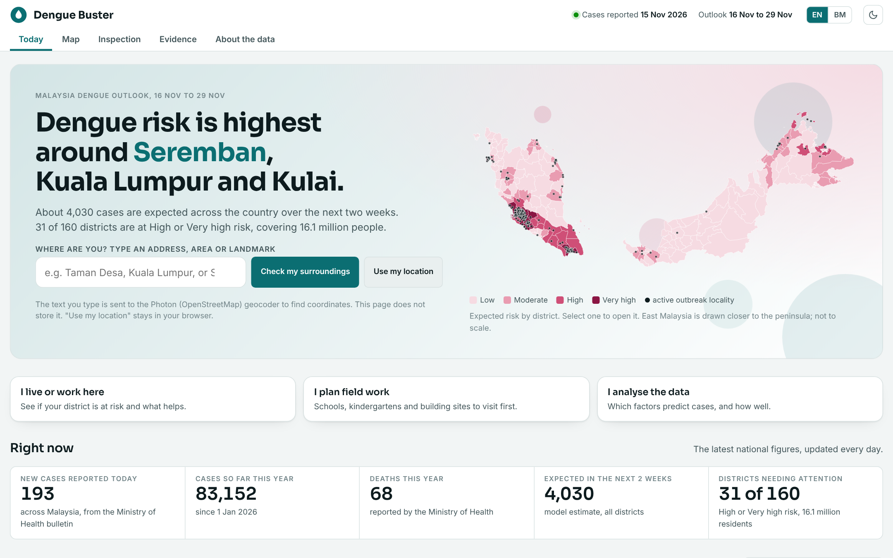

*Dengue Buster, Today page, snapshot of 16 Nov 2026.*

**83,152 cases. 68 deaths. And it is only mid-November.** That is the Ministry of Health's running tally for 2026 as at 15 Nov, and about 4,030 more cases are expected across the country in the next two weeks.

After every heavy rain, the same question comes up in the family WhatsApp group: *is it getting worse where we live?* Until now, the honest answer was "check the state number and guess."

So I built **Dengue Buster**: a free, open-data outlook that puts an expected risk tier on every one of Malaysia's 160 districts, two weeks ahead. *Jom kita tengok.*

---

## The Problem: The Numbers Exist, But Not Where You Live

iDengue publishes daily cases by **state**. That is useful for headlines and not much else. A resident of Seremban, a school manager in Kulai and a district health officer all need to know the same thing at a much smaller scale: *which part of my area should I worry about first, and what should I do about it?*

Malaysia publishes no open district-level case history. So the real challenge was not building a map. It was building something honest with the data that exists.

---

## What It Does, From the User's Seat

The page is organised around who you are, not around the model.

> **🏠 I live or work here** — Type an address or landmark. See your district's risk, outbreak localities, schools, kindergartens and building sites within 1, 2 or 5 km, plus a plain prevention checklist that changes with the risk level.
> **📋 I plan field work** — An inspection queue that ranks schools, kindergartens and construction sites, so limited teams know where to start.
> **📊 I analyse the data** — An evidence tab: what predicts dengue, what does not, and how often the forecast missed.

There is also an English and Bahasa Malaysia switch and a light and dark theme, because a public health tool should be readable by the people it is for.

Each district gets one of four tiers, based on expected cases per 100,000 residents over 14 days:

| Tier | Expected cases per 100,000 (14 days) |
|---|---|
| Low | under 3 |
| Moderate | 3 to 8 |
| High | 8 to 16 |
| Very high | 16 or more |

On the day of the screenshot above, **31 of 160 districts** sit at High or Very high, covering **16.1 million residents**. The top of the list was Seremban, Kuala Lumpur and Kulai.

---

## How the Estimate Is Made

There are four steps, and none of them needs magic.

1. **Read today's cases.** The Ministry publishes state totals every day. That is the only open, current case count.
2. **Adjust for season and weather.** Compare with the usual pattern for this time of year, then nudge for recent warm spells and rain.
3. **Share across districts.** Split each state's number using population, density, local weather and where active outbreak localities are.
4. **Rank and add detail.** Give each district a tier and a likely range, and list the nearby places that matter.

Under the hood, a negative-binomial regression (with a population offset) does the explaining, and boosted trees act as a cross-check. The pipeline is plain Python, runs every day on a schedule, and the whole page is a static site. No login, no paywall, no ads.

---

## What the Evidence Says (Including the Disappointing Parts)

This was my favourite part to build, because the tests were run on years the model had never seen.

- **Recent cases do almost all the work.** Knowing last month's cases cut the average miss from **113 to 72** cases per state-month. Seasonality alone catches the three worst-hit states about 44% of the time; adding recent cases reaches about 75%.
- **Weather helps a little, and later.** It improves a season-only model (113 to 110), but one month ahead it adds nothing once recent cases are known. Rain shows up in cases about **5 to 7 weeks later**, which fits the mosquito life cycle plus incubation. Every link is weak.
- **Some popular ideas did not help.** ENSO and the Indian Ocean Dipole did not improve the forecast, and neither did neighbouring states.
- **Risk clusters.** Expected incidence is strongly clustered (Moran's I = 0.74), so high-risk districts tend to sit beside other high-risk districts. A caution: because district numbers are allocated from state totals, some of that clustering is built in.

I would rather show a weak weather signal than sell a model that "predicts dengue from rainfall." That is the kind of claim that fails in the first big outbreak.

---

## The Limits, Plainly

Please read these before acting on a number.

- **District figures are estimates, not counts.** Treat the tiers as "where to look first."
- **Rankings are priorities, not findings.** A school or building site appears in the inspection queue because of the area's forecast risk, recent rain and nearby outbreaks. It does not mean the site is unsafe or caused any case.
- **Sites come from OpenStreetMap**, and kindergartens and construction sites are under-mapped.
- **This is an independent project on open data, not an official forecast.** For health advice, follow your local health office.
- Aedes indices, fogging and inspection records, serotype shifts and symptom-onset dates are held by the Ministry and are not open. A data-sharing agreement would add the biggest accuracy gain.

---

## What Is Next

The page already lists who it serves and what is still missing. Residents and researchers are covered today. The part not built yet is the working loop: forecast, review, assign an inspection, fix the hazard, verify it was fixed. That needs sign-in, owners, due dates and a database, so it comes next, starting with district health teams, school and kindergarten managers, and construction managers.

If you work in public health, a local council, a school or a construction site, I would genuinely like your feedback on what would make this useful in practice.

---

## Try It Yourself

The outlook is live at [dengue-buster-phi.vercel.app](https://dengue-buster-phi.vercel.app/). Type where you are, read the checklist, and if you see standing water this week, clear it. It takes two minutes.

*Buang air bertakung, selamatkan keluarga.*

---

## Sources & Tools

1. [iDengue — Ministry of Health Malaysia (daily cases, outbreak localities, hotspots)](https://idengue.mohdgov.my)
2. [OpenDengue — historical dengue case data](https://opendengue.org)
3. [NASA POWER — daily rain, temperature, humidity, wind](https://power.larc.nasa.gov)
4. [Open-Meteo — weather forecasts](https://open-meteo.com)
5. [DOSM / data.gov.my — district population, schools, boundaries](https://data.gov.my)
6. [OpenStreetMap — schools, kindergartens, construction sites](https://www.openstreetmap.org)
7. [NOAA CPC — ENSO and Indian Ocean Dipole indices](https://www.cpc.ncep.noaa.gov)
8. [Dengue Buster source code](https://github.com/booluckgmie/dengue-buster)
